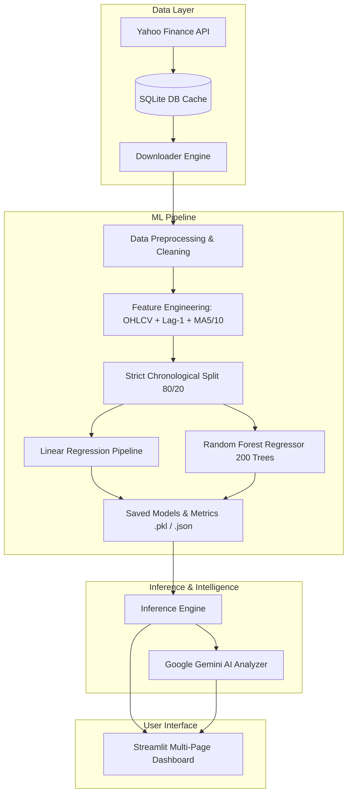

# 📈 Stock Price Predictor & AI Market Intelligence

<div align="center">

[](https://www.python.org/)
[](https://streamlit.io/)
[](https://scikit-learn.org/)
[](https://plotly.com/)
[](https://www.sqlite.org/)
[](https://ai.google.dev/)
[](https://opensource.org/licenses/MIT)

**An enterprise-grade, end-to-end Machine Learning web platform that forecasts next-day closing prices for any global stock, featuring SQLite persistent caching, real-time market data streaming, and Google Gemini AI market intelligence.**

[Key Features](#-key-features) • [Architecture](#-system-architecture) • [Getting Started](#-getting-started) • [ML Pipeline](#-machine-learning-pipeline) • [Dashboard Overview](#-dashboard-pages) • [Project Structure](#-project-structure)

</div>

---

## 🌟 Key Features

- 🌐 **Universal Global Ticker & Company Name Search**: Real-time ticker resolution by company name (e.g., *"Apple"*, *"Tesla"*, *"Tata Motors"*) or ticker symbol for any exchange worldwide (US, NSE, BSE, LSE, TSX, etc.).
- 🤖 **Dual ML Model Suite**:
  - **Linear Regression Pipeline**: Fast baseline with standard scaling for pure trend capture.
  - **Random Forest Regressor**: 200-tree ensemble capturing non-linear market relationships.
- ⚡ **SQLite Caching Engine**: Local SQLite caching database (`stock_cache.db`) with WAL mode and smart gap detection to avoid rate limits and minimize redundant network calls.
- 🧠 **Google Gemini AI Market Insights**: Built-in Generative AI analyzer leveraging the official `google-genai` SDK to produce contextual technical explanations, momentum breakdowns, and risk assessments.
- ⏱️ **Flexible Timeframe Filtering & Inspection**:
  - View full test sets, zoom into specific **Years** and **Months**, or aggregate by **Daily / Monthly Average / Yearly Average**.
  - **Single Day Inspector** with percentage error metrics and best-model identification.
- 📊 **Advanced Interactive Visualizations**:
  - Unified multi-layer charts: Candlesticks + Moving Averages (MA5 / MA10) + Secondary Y-Axis Volume Bars.
  - High-contrast **Actual vs. Predicted** comparison with quick-preset range selectors (`1M`, `3M`, `6M`, `1Y`, `ALL`).
  - Interactive prediction gauge and confidence intervals.
- 🎨 **Modern Dark UI/UX**: Fully custom styling, responsive layouts, glassmorphic hero banners, and vector tech stack branding.

---

## 🏗️ System Architecture



---

## 📁 Project Structure

```text
Stock_predictor/
│
├── app.py                      # Application entry point & multi-page navigation
├── train_models.py             # End-to-end model training & artifact generation
├── requirements.txt            # Project dependencies
├── .env                        # Local environment variables (Gemini API Key)
├── README.md                   # Project documentation
│
├── data/
│   ├── raw/                    # Raw historical CSV backups
│   ├── processed/              # Preprocessed datasets
│   └── stock_cache.db          # SQLite persistent cache database
│
├── models/
│   ├── linear_regression.pkl   # Serialized Linear Regression pipeline
│   ├── random_forest.pkl       # Serialized Random Forest model
│   └── metrics.json            # MAE, RMSE, and R² benchmark metrics
│
├── pages/
│   ├── _shared.py              # Shared CSS, caching helpers, sidebar & search API
│   ├── dashboard.py            # Overview, live snapshot, workflow & tech stack
│   ├── stock_analysis.py       # Advanced charts, candlesticks & moving averages
│   ├── prediction.py           # Next-day inference, gauge chart & Gemini AI
│   └── model_performance.py    # Test-set comparison, timeframe filters & inspection
│
├── src/
│   ├── database.py             # SQLite caching operations & schema
│   ├── downloader.py           # yfinance fetching with fallback logic
│   ├── preprocess.py           # NaN/inf handling and data validation
│   ├── feature_engineering.py  # Feature matrix construction (training & inference)
│   ├── trainer.py              # Chronological splitting & model fitting
│   ├── predictor.py            # Real-time inference controller
│   ├── evaluator.py            # Model evaluation & metric serialization
│   └── llm_analyzer.py         # Google Gemini AI market commentary generator
│
└── utils/
    ├── metrics.py              # Statistical metric calculation (MAE, RMSE, R²)
    └── plotting.py             # Plotly dark-themed visualization factory
```

---

## 🚀 Getting Started

### 1. Prerequisites
- **Python 3.12+** installed on your system.
- Git installed.

### 2. Clone the Repository
```bash
git clone https://github.com/your-username/Stock_predictor.git
cd Stock_predictor
```

### 3. Create & Activate Virtual Environment

**Windows (PowerShell):**
```powershell
python -m venv venv
.\venv\Scripts\Activate.ps1
```

**macOS / Linux:**
```powershell
python3 -m venv venv
source venv/bin/activate
```

### 4. Install Dependencies
```bash
pip install -r requirements.txt
```

### 5. Configure Environment Variables
Create a `.env` file in the project root to enable Gemini AI market explanations:
```env
GEMINI_API_KEY="your_google_gemini_api_key_here"
```
*(Note: If no API key is provided, all forecasting and statistical features remain fully functional without AI text generation.)*

### 6. Train the Machine Learning Models
Train the models on historical multi-ticker datasets:
```bash
python train_models.py
```
This downloads historical data for benchmark tickers, engineers features, trains both models, computes evaluation metrics, and saves the artifacts to `models/`.

### 7. Run the Streamlit Application
```bash
streamlit run app.py
```
Open your browser and navigate to: `http://localhost:8501`

---

## 🧬 Machine Learning Pipeline

### 1. Feature Engineering
The pipeline engineers 7 predictive features from raw market feeds:

| Feature | Category | Formula / Description |
|---|---|---|
| `Open` | OHLCV | Opening price of the trading session |
| `High` | OHLCV | Highest intraday trading price |
| `Low` | OHLCV | Lowest intraday trading price |
| `Volume` | OHLCV | Total trading volume |
| `Prev_Close` | Lag Feature | Prior trading session's closing price ($t-1$) |
| `MA5` | Technical | 5-day Simple Moving Average ($\frac{1}{5}\sum_{i=0}^4 \text{Close}_{t-i}$) |
| `MA10` | Technical | 10-day Simple Moving Average ($\frac{1}{10}\sum_{i=0}^9 \text{Close}_{t-i}$) |

* **Training Target**: Next trading day's closing price ($\text{Close}_{t+1}$).
* **Live Inference**: Today's 7 features are extracted and passed directly into the model to predict tomorrow's closing price.

### 2. Chronological Split (No Data Leakage)
Financial time series exhibit autocorrelation. Random cross-validation shuffles future data into past training sets (lookahead bias). 

We enforce a **strict chronological 80/20 split**:
- **Training Set**: Earliest 80% of historical records.
- **Held-Out Test Set**: Most recent 20% of chronological records.

### 3. Model Architecture
- **Linear Regression Pipeline**:
  - `StandardScaler()` feature normalization.
  - Ordinary Least Squares regression via SVD.
- **Random Forest Regressor**:
  - 200 estimators (`n_estimators=200`).
  - `min_samples_split=5`, `min_samples_leaf=2`.
  - Parallelized CPU execution (`n_jobs=-1`).

### 4. Evaluation Metrics

$$\text{MAE} = \frac{1}{n}\sum_{i=1}^n |y_i - \hat{y}_i| \qquad \text{RMSE} = \sqrt{\frac{1}{n}\sum_{i=1}^n (y_i - \hat{y}_i)^2} \qquad R^2 = 1 - \frac{\sum (y_i - \hat{y}_i)^2}{\sum (y_i - \bar{y})^2}$$

---

## 🖥️ Dashboard Pages

| Page | Description | Key Components |
|---|---|---|
| 🏠 **Dashboard** | High-level system overview & live pulse | Quick-stat tiles, live market quote cards with auto-refresh, company search, ML workflow pipeline diagram, feature engineering reference, vector tech stack. |
| 📊 **Stock Analysis** | Deep-dive market analytics | Combined Candlestick + Volume + MA5/10 chart, 52-week high/low metrics, volatility indicators, and raw OHLCV CSV exporter. |
| 🔮 **Next-Day Prediction** | Tomorrow's price forecasting | Model selection dropdown, prediction gauge, target price delta, confidence intervals, price trajectory chart, and Gemini AI market analysis. |
| 🎯 **Model Performance** | Model benchmarking & evaluation | MAE/RMSE/R² comparison tables, high-contrast Actual vs Predicted chart with range selectors, Year & Month filtering, Daily/Monthly/Yearly resampling, and Single Day Inspector. |

---

## 🛠️ Tech Stack & Libraries

- **Language**: Python 3.12+
- **Frontend & App Framework**: [Streamlit](https://streamlit.io/)
- **Machine Learning**: [scikit-learn](https://scikit-learn.org/), [joblib](https://joblib.readthedocs.io/)
- **Data Manipulation**: [pandas](https://pandas.pydata.org/), [NumPy](https://numpy.org/)
- **Financial Market Data**: [yfinance](https://github.com/ranaroussi/yfinance)
- **Visualizations**: [Plotly Graph Objects](https://plotly.com/python/)
- **Database Caching**: [SQLite3](https://www.sqlite.org/) (WAL mode)
- **Artificial Intelligence**: [Google GenAI SDK](https://github.com/google/genai) (`google-genai`)

---

## ⚠️ Disclaimer

> **Educational & Research Notice**: This software is designed for academic, educational, and portfolio demonstration purposes only. Stock market predictions generated by machine learning algorithms carry inherent uncertainty and should **never** be considered financial, investment, or trading advice. Past performance does not guarantee future results.

---

## 🔧 Customization

To add more tickers to the default training pool, edit `train_models.py`:

```python
TICKERS: list[str] = [
    "AAPL", "MSFT", "GOOGL", "TSLA",
    "TCS.NS", "RELIANCE.NS",  # Add Indian tickers (NSE)
    "NVDA", "META", "AMZN",   # Add global tickers
]
```

Then re-train the models:
```bash
python train_models.py
```

---

## 📄 License

This project is licensed under the **MIT License** — free to use, modify, and distribute for educational and personal projects.
